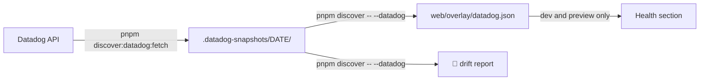
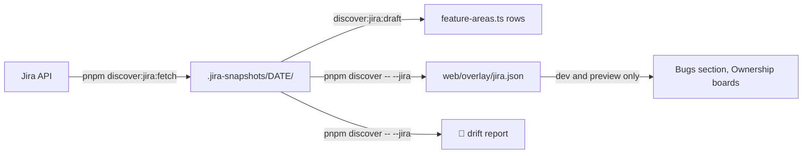
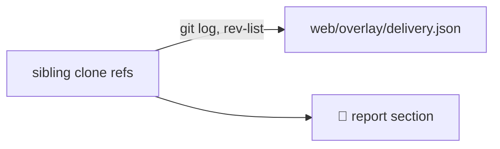

# Discovery

`packages/discovery` scans the sibling Skello repos and reports drift between the dataset and the code ([ADR-0007](../adr/0007-discovery-semantics.md)).

## What it reads

- **Code and config:**
  - SDK usage;
  - serverless config: HTTP, SQS, Kinesis/DynamoDB streams, S3 triggers, EventBridge schedules;
  - serverless event sources and owned CloudFormation resources (🌀 report section), which feed the `RecurringTask` model and the CDC backbone edges;
  - Rails clients and routes;
  - frontend env usage.
- **Application-code AWS clients** (🔧 report section):
  - Kinesis/Firehose produce, S3 reads and writes, DynamoDB CRUD and TypeORM Postgres coupling;
  - each compared with `service.databases`, in both directions.
- **Terraform ground truth** (the `<service>-tf` checkouts; 🏗 report section):
  - owned resources and `terraform-aws-modules` stores;
  - DMS replication tasks, which prove the aurora → kinesis CDC backbone, and the streams they feed;
  - MongoDB Atlas user roles and IAM actions.
- **Table listeners** (👂 report section):
  - callbacks, concern bodies included, with `if:` / `unless:` kept as source text;
  - `dependent:` cascades, `touch: true` and gem hooks: `acts_as_list`, `has_ancestry`, `multisearchable`, `has_secure_token`, `devise` and geocoder's `geocode` / `reverse_geocode`, provided by `geocoded_by` / `reverse_geocoded_by`;
  - `has_and_belongs_to_many` destroys its join table, and `has_ancestry` descendants are destroyed by default, or re-parented under `orphan_strategy:` `:adopt` / `:rootify`;
  - the jobs callbacks enqueue and the callee one call level below them, so `Shift` → `ShiftCallbackJob` → `WeeklyOption.upsert_employee_change!` reaches `weekly_options`;
  - write sites classified by the listeners they run, each statement read whole (multi-line chains and the call's own arguments); raw SQL `INSERT`, `UPDATE` and `DELETE` run none, and `run_callbacks(:phase)` fires that phase's listeners;
  - the CDC feed: the CDC task replicating each table to its stream, and the per-table stream consumers whose `filterPatterns` name the table's prefix.
- **Product-area code locations:**
  - glob liveness;
  - monolith, front and mobile coverage;
  - glossary anchors;
  - external-system evidence.
- **Flow verification** at the pinned commit:
  - unit paths and call-edge grades (see [flows.md](flows.md#the-code-layer-and-its-grades));
  - branch literals, domain-rule stamps, flags, DLQs, auth refs and PII refs;
  - ⚙ state machines: each authored machine against its Step Functions definition — states, types, transitions, catches, concurrency, task handler files, and states in code the flow does not declare (see [flows.md](flows.md#state-machines)).
- **Live AWS state** (Layer 4), compared with the map: a read-only account snapshot of event source mappings, subscriptions and filter policies, DMS tasks, bucket notifications and schedules.
  - Snapshots are gitignored.
  - A snapshot is written whole or not at all: a fetch that fails midway leaves no folder, and a folder missing a file stops the run with a `SnapshotFormatError` instead of reading as an empty account.
  - Sandbox account only, per the credentials story (`research/aws-live-verification-credentials.md` in the shared docs).
- **Datadog state** (🐶 report section): a read-only snapshot of monitors, SLOs, teams, open incidents, request and error series, DLQ depth and monitor transitions, joined to the map by service name. It feeds the web app's [Health section](explorer.md#health) and is described in [Datadog snapshot and overlay](#datadog-snapshot-and-overlay).
- **Jira bug reports** (🎫 report section): a read-only snapshot of the `BR` project's bugs, Feature Area values and boards, joined to the map through the authored [Feature Area map](data.md#feature-areas) and the teams' `jiraBoards`. It feeds the [Bugs section](explorer.md#bugs) and is described in [Jira snapshot and overlay](#jira-snapshot-and-overlay).
- **Delivery** (🚚 report section): each mapped clone's prod and `staging` branches, read with `git` alone. It feeds the [Delivery section](explorer.md#delivery) and is described in [Delivery line](#delivery-line).

## Commands

```bash
pnpm discover                 # scan sibling Skello repos → classified drift report
pnpm discover -- --pinned     # same, against each repo's production branch (master; main for *-tf) as detached worktrees in .pinned/
pnpm discover:apply           # pinned run + regenerate the discovered overlay (provenance stamps, call-edge grades), the monolith routes and listeners.json; refuses to run unpinned
pnpm discover:baseline        # pinned run + rewrite packages/discovery/baseline.json (accepted findings and scanned repo set)
pnpm discover -- --pinned --fail-on-new   # exit 1 when a finding is not in the baseline, or a baseline repo was not scanned
pnpm --filter @dependency-explorer/discovery discover:unit-paths   # exit 1 when a flow unit's file is missing at its pinned commit; counts units it skips (repo not cloned, not pinned, or its pinned commit not fetched)
pnpm --filter @dependency-explorer/discovery discover:grades       # replay call-edge grades against the existing pinned worktrees, no re-pin
pnpm --filter @dependency-explorer/discovery discover:machines     # check flow state machines against the pinned definitions (⚙), no re-pin
pnpm --filter @dependency-explorer/discovery discover:listeners   # listeners at the pinned skello-app: extraction findings (unresolved-callback, unresolved-job, unknown-gem-macro) and listener counts for the busiest tables
pnpm discover -- --aws [dir]  # + 🛰 live AWS snapshot diff (defaults to the latest snapshot)
pnpm discover:aws:fetch --profile skl-sandbox   # capture a read-only snapshot (~215 calls, MFA'd session required)
pnpm discover:datadog:fetch   # capture a read-only Datadog snapshot (needs DATADOG_API_KEY and DATADOG_APP_KEY)
pnpm discover -- --datadog [dir]   # + 🐶 Datadog drift, and write the web overlay (defaults to the latest snapshot)
pnpm discover:jira:fetch      # capture a read-only Jira snapshot (needs JIRA_EMAIL and JIRA_API_TOKEN)
pnpm discover:jira:draft   # print feature-areas.ts rows for every Feature Area of a snapshot
pnpm discover -- --jira [dir] # + 🎫 Jira drift, and write the web overlay (defaults to the latest snapshot)
pnpm discover -- --delivery   # + 🚚 delivery, and write the web overlay from the clones' branches
pnpm discover -- --pinned --no-fetch   # pin against the local origin refs, with no `git fetch`
pnpm --filter @dependency-explorer/discovery golden:update   # rewrite the golden files after an intended output change
pnpm docs:gen                 # rewrite the generated sections of the inventory docs (CI fails on drift)
```

Every discovery command stops with its usage on a flag it does not know, instead of ignoring it.

`--pinned` runs fail when they pin no repo — run discovery from the main clone; a `.claude/worktrees` checkout finds no sibling repos.

Pinning touches only `.pinned/<repo>` in each clone: it adds or re-checks-out that detached worktree, and a failed pin removes it again. It never prunes the clone's other worktrees.

**Connection stamps.** A connection is stamped per channel, keyed `from→to:protocol` in `discovered.json`. Evidence stamps the channel whose protocol it proves: a stream consumer or a DMS task proves `cdc` (or `kinesis`), an SDK import or an HTTP client `rest`, a queue literal `sqs`, a bucket notification `s3`. A pair mapped under one protocol takes any evidence for it; a pair mapped under several leaves a channel without matching evidence unstamped, and the report lists it as stale or unverifiable with its protocol. The baseline keys that drift by channel too (`stale||svc-hiring→skello-app:rest|`), so losing one channel's evidence never hides behind the other's.

## Datadog snapshot and overlay

Two commands, run in order from the main clone, turn Datadog state into the web app's Health section. Nothing Datadog returns is committed or shipped: snapshots and the overlay are gitignored, and the built bundle never contains them ([ADR-0010](../adr/0010-datadog-overlay-from-a-local-snapshot.md)).



**Fetch.** `pnpm discover:datadog:fetch [--out <dir>]` reads Datadog with your own keys and writes `packages/discovery/.datadog-snapshots/<YYYY-MM-DD>/` (gitignored). `--help` prints the usage.

| Setting | Value |
|---|---|
| `DATADOG_API_KEY`, `DATADOG_APP_KEY` | Required, from the environment only; never written to a file or printed |
| `DD_SITE` | Datadog site, default `datadoghq.eu` |
| Application key scopes | `monitors_read`, `slos_read`, `teams_read`, `incident_read`, `timeseries_query`, `events_read` |

- Datadog is read-only: GET calls, plus the events search, a POST that reads. No log lines, incident bodies, monitor messages or monitor queries are fetched.
- Metrics cover 21 days (APM series 14 days), monitor transitions 7 days.
- A metric Datadog refuses is reported as unavailable and left empty in the snapshot; the rest is still written.
- Exit code 1: a key is unset, Datadog refuses the keys (`Datadog refused the keys (HTTP 403)`, with no folder written), a request fails, or the target folder holds files other than a Datadog snapshot (it is never replaced).
- The folder is written whole or not at all, and re-running on the same day replaces that day's snapshot.

**Discover.** `pnpm discover -- --datadog [dir]` reads a snapshot (the latest by default, or `dir`, a path such as `.datadog-snapshots/2026-11-02`, resolved against the current directory, the repo root, then `packages/discovery`; a bare folder name does not resolve), prints the 🐶 section and writes `packages/web/overlay/datadog.json`, validated by `DatadogOverlaySchema` ([data.md](data.md#datadog-overlay)). Without `--datadog`, discovery reads no snapshot, prints no 🐶 section and writes no overlay.
- A snapshot file that is missing, unreadable or off the current snapshot format stops the run with exit code 1 before any report prints, naming the file; re-run `pnpm discover:datadog:fetch`.
- Incident links open the incident by its public number in Datadog.

**Release verdicts.** Releases come from the local clones: merge commits on each service's production branch as `origin` holds it (`origin/master`, the ref the Delivery line reads) over the last 14 days, or on `HEAD` of the pinned worktree when the run is `--pinned`. A service with no checkout under the repo base is skipped with `releases of <service> skipped: no checkout`. Each merge is judged against the 72 hours after it, compared with the same hours a week earlier:
- `Regressed`: 5xx, Lambda errors or p95 latency rose past the bars below, and the merge has a full week of baseline inside the snapshot window (an earlier merge is never `Regressed`);
- `Steady`: no rise;
- `Too recent`: the merge is under 72 hours old.

**Health states.** A service is in the first state that applies:

| State | Meaning |
|---|---|
| Problem now | 5xx, Lambda errors or p95 latency rose over the last 72 hours and are still elevated over the last 24 hours |
| To dig into | a route, function or DLQ is failing without a service-wide problem |
| Fell back | a day in the last 7 days, before the last 24 hours and before the start of any open problem, was bad and no longer holds |
| Healthy | measured, none of the above |
| No data | no metric reads |

The bars come from skello-cockpit's code: a 5xx rise needs 3× the week before and at least 20 more errors (5 over the last 24 hours); a Lambda-error rise 1.5× and at least 100 more (30 over 24 hours); p95 1.5×. A monitor is noisy at 50 transitions in 7 days.

**Drift (🐶).** The section lists where Datadog and the map disagree, each finding with its fix:

| Kind | Meaning |
|---|---|
| `unknown-service` | a Datadog service or API name matches no map service |
| `unmonitored-service` | a map service (clients excepted) has no prod monitor and no SLO |
| `unknown-dlq` | a DLQ Datadog reports matches no registry DLQ |
| `silent-dlq` | a registry DLQ has no depth series, because the deployed queue is not tagged `sqsdlq:true`; reported only when the snapshot read the DLQ metric |
| `team-mismatch` | the Datadog team on a service's monitors differs from its CODEOWNERS team, or is in no team's `datadogTeams` |

Names match across spellings: `svc-alpha` and `svcalpha` fold into one map service.

**Why advisory.** 🐶 findings never enter `baseline.json` and never trip `--fail-on-new`. They carry operational names, and nobody else can reproduce a run on your local snapshot, so the nightly job could not check them.

## Jira snapshot and overlay

The same path as Datadog turns Jira bug reports into the web app's Bugs section. Bug keys stay in the gitignored snapshot; the overlay holds counts, Feature Area labels, board names and Jira search links, and the built bundle never contains it ([ADR-0011](../adr/0011-jira-overlay-and-feature-area-map.md)). No bug title, description, comment or person is read.



**Fetch.** `pnpm discover:jira:fetch [--out <dir>]` writes `packages/discovery/.jira-snapshots/<YYYY-MM-DD>/` (gitignored). `--help` prints the usage.

| Setting | Value |
|---|---|
| `JIRA_EMAIL`, `JIRA_API_TOKEN` | Required, from the environment only; never written to a file or printed |
| Token | A classic API token without scopes, created at id.atlassian.com → Security → API tokens; a scoped token only works through `api.atlassian.com` |
| `JIRA_HOST` | Default `skello.atlassian.net` |

- Jira is read-only, GET calls only: the account (`myself`), the site's statuses, every Feature Area value (`cf[11070]`, read by autocomplete prefix and kept raw), every board, the `BR` search, and the open BRs of each board listed in a team's `jiraBoards`.
- Scope: `project = BR AND issuetype = Bug AND status != Deleted`, bugs open now or created in the last 90 days. Open means `statusCategory != Done` or a to-ship status (`QA`, `Go for MEP`) the site has. Bugs resolved as `Not a bug`, `Won't Do`, `Won't do`, `Duplicate` or `Cannot Reproduce` are dropped.
- Each bug keeps its key, creation date, status and category, priority, first Feature Area value and SLA-breached flag.
- At most 4 requests in flight; HTTP 429 is retried up to 5 attempts, honouring `Retry-After`.
- Exit code 1: a variable is unset (each missing one is named), Jira refuses the credentials (`Jira refused the credentials (HTTP 401): use a classic API token without scopes`, with no folder written), a request fails, or the target folder holds files other than a Jira snapshot.
- The folder is written whole or not at all, and re-running on the same day replaces that day's snapshot.

**Draft.** `pnpm discover:jira:draft [--snapshot <dir>]` prints one `feature-areas.ts` row per Feature Area of the latest snapshot, and per label seen only on its BRs: the raw label, its tribe from skello-cockpit's catalog (`null` when the catalog does not know it), `area: null`, and a trailing note with the catalog name and open BR count. Set each `area` before pasting the rows, and drop the notes.

**Discover.** `pnpm discover -- --jira [dir]` reads a snapshot (the latest by default, `dir` resolved as for `--datadog`), prints the 🎫 section and writes `packages/web/overlay/jira.json`, validated by `JiraOverlaySchema` ([data.md](data.md#jira-overlay)). Without `--jira`, discovery reads no snapshot, prints no 🎫 section and writes no overlay.
- A bug's area is its first Feature Area value through `feature-areas.ts`; no value, a value missing from the map, or one mapped to `null` counts as unmapped.
- A bug's teams are those whose `jiraBoards` hold it; a bug on two teams' boards counts once in its area and once under each team.
- `weekly` counts BRs opened per ISO week (Monday, UTC), the 13 weeks ending with the snapshot's week, oldest first; the last one is partial.

**Drift (🎫).** The section lists where Jira and the map disagree, each finding with its fix:

| Kind | Meaning |
|---|---|
| `unmapped-label` | a Feature Area value in Jira is missing from `feature-areas.ts` (with its open BR count) |
| `gone-label` | a value in `feature-areas.ts` that Jira no longer offers; not reported when the label walk was cut |
| `labels-capped` | the Feature Area autocomplete walk ran out of calls (150) or still had full answers at two characters, so the label list may be incomplete |
| `unknown-board` | a team's `jiraBoards` names a board Jira does not have |
| `board-suggestion` | a board whose name contains a team's name (without "Team") is not in that team's `jiraBoards` |
| `unlisted-label` | a value seen on BRs that Jira's Feature Area list no longer offers |

🎫 findings are advisory for the same reasons as 🐶: they stay out of `baseline.json` and `--fail-on-new`.

## Delivery line

`pnpm discover -- --delivery` reads, for each scanned repo named like a map service, what waits on its `staging` branch before prod. It reads the clones under the source base, never the pinned worktrees, and needs no token.



- **Prod:** `origin/master`, else `origin/main`. A clone with neither has no entry; a ref git cannot read skips the repo with a 🚚 line.
- **Staging:** the only branch read, when `origin/staging` exists. `sandbox` is never read: in `skello-app` and `skello-app-front` it holds work nobody validated, so a change counts once it reaches `staging`. A clone without `staging` shows its last release alone.
- **Changes:** the merges of the last 90 days that `origin/staging` contains and prod does not, at any depth, so a feature promoted inside a `sandbox → staging` merge counts. Promotions are not changes: merges of `sandbox`, a team sandbox (`sandbox-<team>`), `staging`, `master` or `main`, as `Merge pull request #<n> from <org>/<branch>`, `Merge branch '<branch>'…` or `Merge remote-tracking branch 'origin/<branch>'…`. A team sandbox merged into `staging` counts as the PRs it carries.
- **Age:** French working days from the merge day to the run day, both in Europe/Paris, weekends and public holidays (Easter Monday, Ascension and Whit Monday included) left out. A Friday merge read on Monday is 1.
- **Late:** the oldest waiting change has waited 3 working days or more.
- **Title:** the merge body's first non-empty line (the PR title), else the subject.
- **Last release:** the latest first-parent merge into prod; its version is `release vX.Y.Z` in the title, else `#<PR number>`.
- **Fetch:** a pinned run fetches `staging` by name after the pin (`git fetch --quiet origin staging`, no wildcard, no `--prune`); `--no-fetch` skips it. `fetchedAt` is the mtime of the clone's `.git/FETCH_HEAD`.

**Overlay.** `packages/web/overlay/delivery.json`, validated by `DeliveryOverlaySchema` ([data.md](data.md#delivery-overlay)), gitignored and never in `dist/`.

**🚚 section** (advisory, out of `baseline.json` and `--fail-on-new`):

- one line per late service, oldest first: `svc-reports: 8 on staging, oldest 5 working days (<title>)`;
- each repo a git call failed on, with the error: `svc-x skipped: fatal: …`; the run goes on;
- each repo whose prod moved since its oldest waiting merge yet holds none of its first-parent `staging` merges of 90 days, the sign of squashed promotions: `svc-x: prod moved since its oldest waiting merge, yet holds none of its staging merges of 90 days: are promotions squashed?`;
- each clone fetched more than 3 days before the run: `svc-reports fetched 2026-11-09: run with --pinned to refresh`.

## Gates

The test suite guards discovery's behaviour and keeps tests off the network.

- **Golden test** (`src/golden.test.ts`): runs `runDiscovery` and `writeOutputs` over a fictitious workspace built in a temp directory, and compares every generated dataset and the whole report with `src/__golden__/expected/`. A diff fails the test. After an intended change, run `golden:update`, then review the rewritten files in the diff.
- **Covered sections:** every report section must hold data in the fixture, or be listed in the test's `NOT_COVERED` map with the reason it cannot. A section without fixture data fails the test until it is covered or listed.
- **Network guard** (`test-support/guard.ts`): every test refuses outbound requests except to `localhost`, and refuses to spawn `aws`, `gh`, `curl` or `graphify`.
- **`AGENTS.md`:** the repo's agent guidance: commands, hard rules and a code → doc sync table. A change to a code path in that table updates its doc in the same change.
- **Exact pins:** every dependency in every `package.json` carries an exact version, never `^` or `~`; a new dependency takes a version published at least two weeks earlier.
- **Unused code:** `pnpm check:exports` (knip) fails on an unused file, export or type.
- **`--no-fetch`:** a pinned run fetches each repo's origin first (prod for the pin, then `staging` with `--delivery`); `--no-fetch` skips both, for offline runs and tests. `DE_FIXED_NOW` (an ISO date) fixes the run's clock for reproducible output.

## Listener drift (👂)

The 👂 section checks the table listener surface at the pinned commit. A skello-app that is not pinned is skipped. Findings carry a kind, a subject and a detail; accepted findings enter `packages/discovery/baseline.json` through `pnpm discover:baseline`. `surface-drift`, `cdc-unknown-table` and the two `flow-listener-*` kinds come from the full `pnpm discover` run; `discover:listeners` prints the extraction kinds only.

| Kind | Meaning |
|---|---|
| `surface-drift` | listeners, write sites or CDC relations at the pin differ from the committed `listeners.json` / `resources.json`: `discover:apply` is due. Line numbers never count: a listener is compared by id, events, phase, condition and effects (kind, target, target file, via, mode, runs, events), and write sites as a multiset of table, file, call, runs, events and fires |
| `unresolved-callback` | a callback symbol with no `def` in the model or its included modules |
| `unresolved-job` | an enqueued constant with no file under `app/jobs/` |
| `unknown-gem-macro` | a class macro outside Rails associations and `KNOWN_GEM_LISTENERS` |
| `cdc-unknown-table` | a CDC selection rule naming a table absent from `db/schema.rb`; `ar_internal_metadata`, `schema_migrations` and `pg_stat_statements` are exempt |
| `flow-listener-missing` | a listener a flow fires that its `model-callback` units do not draw, for example `shifts.before_save.set_new_default_poste writes memberships` on `shift-update` |
| `flow-listener-unsupported` | an edge drawn from a `model-callback` unit that no fired listener backs |

The flow rows come from `flowListenerDrift(flow, surface)` in `packages/data`. A flow's `model-callback` units are compared with the listeners its write-site links fire:
- edges into job units match the fired listeners' direct `enqueues` effects by `targetFile`;
- edges into `postgresql` stores match their direct `writes` effects (no `via`) by table;
- edges from a `model-callback` unit to non-job code units are not compared;
- table-event fallback links are not compared;
- a flow without a `model-callback` unit is not compared;
- edges into non-table stores such as Redis are not compared.

At `3f6728f`, `cdc-unknown-table` reports `audits`, `organisation_monthly_stats`, `shop_holiday_settings` and `user_holiday_settings`.

## Nightly discovery

`.github/workflows/discovery-nightly.yml` runs on manual dispatch only until the `DISCOVERY_READ_TOKEN` secret exists; with it, its schedule (every night at 03:00 UTC) returns.

**What it runs:**
1. It clones every repo that `pnpm --filter @dependency-explorer/discovery repo-list` prints: the baseline's scanned set, plus every dataset service and its `-tf` repo.
2. Each repo is cloned at its production branch, using the `DISCOVERY_READ_TOKEN` repository secret (org read access).
3. It then runs `pnpm discover -- --pinned --fail-on-new`.

**Output:** the report is the job summary and the `discovery-report` artifact. The job opens no pull requests.

**When it fails:**
- **A new finding:** a finding missing from `packages/discovery/baseline.json` turns the job red.
- **A missing repo:** so does a repo from the baseline's scanned set that was not pinned, since its findings would otherwise read as resolved.
- **No secret:** without `DISCOVERY_READ_TOKEN`, the job fails at its first step with `secret DISCOVERY_READ_TOKEN not configured`.

Accepting drift is a reviewed commit of `pnpm discover:baseline`.
